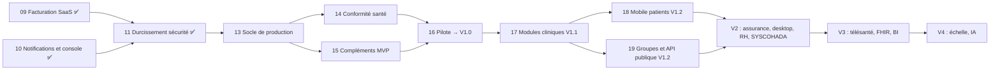

# 12 — Schéma de travail : du cahier des charges au produit

> Document de pilotage (créé le 2026-10-11). Il relie chaque exigence de `cahier-des-charges.md` à son état dans le dépôt et à la phase qui la livrera. **Claude le lit en premier** avant tout nouveau travail, et le tient à jour à la fin de chaque phase.
> Il ne remplace pas la conception : `00` à `07` restent la référence, `06-roadmap-mvp.md` le découpage en versions, et chaque phase a son contrat (`09`, `10`, `11`, puis `13`…).
> Le graphe de connaissance (`graphify-out/`, non versionné) relie ce document, le cahier des charges, la conception et le code. Voir §5.

## 1. Protocole à suivre par Claude

### 1.1 Choisir le travail
1. Lire ce document, puis la mémoire du projet.
2. Le prochain travail est la **première phase du §4 dont le statut n'est pas ✅**, sauf si l'utilisateur en désigne une autre.
3. Une exigence marquée « à vérifier » doit être vérifiée dans le code (ou par `graphify query`) avant d'être planifiée.

### 1.2 Mener une phase (même cycle que les phases 09 à 11)
| Étape | Action | Sortie |
|---|---|---|
| 1. Contrat | Rédiger `docs/NN-phase-<nom>.md` : périmètre, hors périmètre, décisions numérotées, contrats d'API, schéma, scénarios de tests, test de fumée. Conforme à `00`–`07` ; en cas d'écart, le contrat prime pour la phase. | Contrat soumis à l'utilisateur |
| 2. Arbitrages | Poser les questions ouvertes **avec une recommandation** ; consigner les réponses comme décisions datées. | Section « Questions ouvertes » arbitrée |
| 3. Branche | `feat/<nom-de-phase>` depuis `main`. | — |
| 4. Réalisation | TDD (test d'abord), un module Nest par domaine, RLS sur toute table tenant, permissions déclarées dans `packages/shared`, audit des opérations sensibles. | Suites vertes |
| 5. Revue | Revues code, sécurité, et santé si données patient ; corriger CRITICAL et HIGH. | Correctifs |
| 6. Test de fumée | Jouer le test de fumée du contrat dans un navigateur (et en topologie de prod si le déploiement change). | Compte rendu point par point |
| 7. Clôture | Mettre à jour ce document (§2 et §4), `06-roadmap-mvp.md` si le périmètre bouge, la mémoire du projet ; relancer `graphify update .`. | Statuts à jour |

### 1.3 Règles permanentes
- **Aucun commit ni push sans accord explicite** de l'utilisateur ; un accord ne vaut que pour les changements présentés.
- Ne jamais commiter `graphify-out/`.
- Isolation des tenants : toute nouvelle table métier porte `tenant_id`, RLS activée **et forcée**, avec un test d'isolation.
- Données de santé = données sensibles : chiffrement des champs sensibles, audit des accès, aucune donnée de santé dans les SMS ni dans les journaux.
- Marché cible : Afrique francophone (connectivité instable, Mobile Money, XOF/XAF/CDF/USD, SYSCOHADA, lois CDP/ARTCI).

## 2. Matrice de traçabilité (état au 2026-10-11)

Légende : ✅ livré · 🟡 partiel · ⬜ à faire. « Où » renvoie au code ou au document de référence ; « Cible » à la phase du §4 ou à la version de `06`.

### 2.1 Plateforme, tenants, sécurité (§1 à §4, §7 à §11 du cahier)
| Exigence | État | Où | Reste à faire | Cible |
|---|---|---|---|---|
| Inscription d'un établissement, choix du type, vérification d'e-mail | ✅ | `modules/onboarding`, web `(public)/inscription` | Modèles d'onboarding pharmacie et labo | P17 |
| Types d'établissements (12) | ✅ | `packages/shared` (EstablishmentType) | — | — |
| Activation de modules par établissement | 🟡 | modèles `Module`, `TenantModule`, droits du plan | Add-ons de modules, écran de sélection à l'onboarding (à vérifier) | P17 |
| Isolation multi-tenant (RLS forcée, rôle sans BYPASSRLS) | ✅ | `infrastructure/prisma/tenant-db.service.ts`, migrations `*_security_rls` | Test d'isolation pour chaque nouvelle table | permanent |
| Super Administrateur : tenants, plans, abonnements, factures, KPI | ✅ | `modules/platform`, `modules/subscriptions`, web `(platform-app)` | Console sur sous-domaine distinct, transfert du principal par la console | P14 |
| Super Admin : licences, intégrations, maintenance | ⬜ | — | Licences signées (avec le desktop), gestion des intégrations | V2 |
| Rôles système et personnalisés, RBAC avec portées établissement/site/service | ✅ | `modules/iam`, `packages/shared` (catalogue de permissions) | Portée **groupe** | P19 |
| Hiérarchie des administrateurs, MFA hors réseau des rôles cliniques | ✅ | `docs/11` | Revue périodique des affectations | P14 |
| Authentification : Argon2id, JWT + refresh rotatif, TOTP, codes de secours, mot de passe oublié, délai progressif | ✅ | `modules/auth`, `docs/11` | WebAuthn, SSO SAML/OIDC | V2 |
| Journal d'audit chaîné, consultation, vérification | ✅ | `common/audit`, web `administration/journal` | Ancrage WORM, vérificateur planifié, « qui a consulté ce patient » | P14 |
| Chiffrement des données sensibles | 🟡 | chiffrement applicatif + index aveugle | KMS/Vault, clés par tenant, rotation | P14 |
| Chiffrement des communications | ✅ | Traefik TLS, HSTS, SMTP STARTTLS exigé en prod | — | — |
| Sauvegardes automatiques et restauration | ⬜ | — | Sauvegardes quotidiennes, restauration testée et chronométrée, puis PITR | P13 |
| Multi-sites : établissement → site → service | ✅ | `modules/org`, web `administration/organisation` | Horaires, adresse, téléphone des sites ; fuseau par site | P15 |
| Groupe multi-établissements | ⬜ | — | Groupes, consolidation, portée groupe | P19 |
| Abonnements : plans versionnés, essai, droits et quotas, factures SaaS, Mobile Money, relances | ✅ | `docs/09`, `modules/subscriptions`, `modules/payments` | Second agrégateur, rapprochement automatisé, prorata automatique | P17 |
| Tableaux de bord plateforme et établissement | 🟡 | `DashboardsController`, web `(platform-app)/plateforme` | Incidents et alertes plateforme, tableaux par rôle | P15 |
| Notifications : e-mail, SMS, in-app (sondage), modèles, préférences, rappels | 🟡 | `docs/10`, `modules/notifications` | Push mobile, Web Push, WebSocket, console des modèles et du journal d'envoi | P15, P18 |
| Gestion des fichiers et documents | ⬜ | MinIO retiré (`docs/11` D13) | Stockage objet S3 et service de documents | P13 |
| Observabilité (traces, métriques) | ⬜ | journaux Pino seulement | OpenTelemetry, métriques, alertes | P13 |
| CI/CD | ⬜ | aucun pipeline dans le dépôt | Lint, typecheck, tests, build d'images, scan de secrets et dépendances | P13 |
| Déploiement de référence | ✅ | `infra/deploy` (Traefik, secrets Docker), validé au test de fumée §12 de `docs/11` | Kubernetes | V4 |

### 2.2 Modules métier (§5 du cahier)
| Module | État | Où | Reste à faire | Cible |
|---|---|---|---|---|
| A. Patients : enregistrement, IPP, recherche, doublons, contacts, consentement aux rappels | ✅ | `modules/patients`, web `patients` | Fusion de doublons (identitovigilance), droits du patient, import CSV | P14, P16 |
| A. Dossier clinique : antécédents, allergies, groupe sanguin, documents, historique des soins | ⬜ | — | Dossier patient clinique | P17 |
| B. Rendez-vous : agenda, statuts, file du jour, rappels SMS | ✅ | `modules/appointments`, web `rendez-vous` | — | — |
| B. Disponibilités et absences des praticiens | ⬜ | US-111 renvoyée (`docs/06` annexe) | Modèles de disponibilités, absences | P15 |
| B. Prise de RDV en ligne, listes d'attente, ressources, RDV récurrents | ⬜ | — | Portail patient puis mobile | P17, P18 |
| C. Gestion médicale : consultations, diagnostic, prescriptions, ordonnances, actes | ⬜ | — | Dossier clinique | P17 |
| C. Soins infirmiers, hospitalisation, sortie | ⬜ | — | Hospitalisation simple (admissions, lits) puis avancée | V2, V3 |
| D. Laboratoire | ⬜ | — | Catalogue, demandes, prélèvements, résultats, validation, compte rendu PDF | P17 |
| E. Pharmacie | ⬜ | — | Dispensation, vente comptoir, ordonnances | P17 |
| F. Stocks | ⬜ | — | Articles, lots, péremptions, mouvements, inventaires, alertes | P17 |
| G. Ressources humaines et paie | ⬜ | praticiens seulement (`modules/org`) | Personnel, contrats, plannings, congés, paie | V2 |
| H. Facturation patient et caisse | ✅ | `docs/09`, `modules/billing`, web `facturation`, `caisse` | Avoirs, remises, mentions légales, rapport Z, reçu thermique | P16 |
| H. Comptabilité SYSCOHADA | ⬜ | — | Plan de comptes, journaux, écritures automatiques, états financiers | V2 |
| I. Assurance et tiers payant | ⬜ | — | Conventions, prises en charge, bordereaux, rejets | V2 |

### 2.3 Applications (§6 du cahier)
| Application | État | Où | Cible |
|---|---|---|---|
| Web (BFF Next.js, CSP à nonces) | 🟡 | `apps/web` — administration, patients, RDV, facturation, caisse, abonnement | Écrans des modules à venir |
| API REST `/api/v1` | 🟡 | `apps/api`, `docs/03-api.md` | OpenAPI générée en CI (P13), API publique et webhooks sortants (P19) |
| Mobile patients (Expo) | ⬜ | — | P18 |
| Desktop hors-ligne (Tauri) | ⬜ | — | V2 |
| Mobile professionnels | ⬜ | — | V2 |

## 3. Vue d'ensemble des dépendances

## 4. Phases restantes

Le numéro de phase est aussi celui de son futur contrat (`docs/13-phase-….md`, etc.). Les durées viennent de `06` et seront réévaluées dans chaque contrat.

### P11 — Durcissement sécurité ✅
Contrat `11-phase-durcissement-securite.md`, branche `feat/durcissement-securite` (commits `99ac846`, `bb42343`, `57be7e7`). Décisions 1 à 26 livrées, test de fumée §12 joué en entier. **Reste** : fusionner la branche dans `main` après accord.

### P13 — Socle de production ⬜
- **Objectif** : rendre la plateforme exploitable : rien ne part en production sans pipeline, sauvegarde ni stockage de documents.
- **Contenu** :
  - CI (lint, typecheck, tests unitaires et e2e sur Postgres, build des images, `check-pinned-images.sh`, scan de secrets et de dépendances, OpenAPI générée) ;
  - sauvegardes quotidiennes chiffrées, restauration testée et chronométrée (RPO ≤ 24 h, RTO ≤ 4 h) ;
  - stockage objet S3 et service de documents (choix du remplaçant de MinIO) ;
  - OpenTelemetry, métriques et alertes ;
  - Renovate.
- **Sortie** : CI obligatoire sur les PR ; exercice de restauration consigné ; un document téléversé puis relu sous RLS.

### P14 — Conformité santé avant production ⬜
- **Objectif** : prérequis du lot 2 de `06` à toute mise en production dans un établissement réel.
- **Contenu** :
  - identitovigilance (fusion et dé-fusion, rôle DIM) ;
  - droits du patient (consentements, export, « qui a consulté mon dossier ») ;
  - bris de glace et ABAC « lien de soins » ;
  - chiffrement par KMS, clés par tenant et rotation ;
  - audit ancré en WORM avec vérificateur planifié ;
  - console plateforme sur sous-domaine distinct ;
  - revue périodique des affectations.
- **Sortie** : revue santé et revue sécurité sans point bloquant.

### P15 — Compléments fonctionnels du MVP ⬜
- **Contenu** :
  - disponibilités et absences des praticiens (US-111) ;
  - horaires, adresse, téléphone et fuseau des sites ;
  - indicateur « service sensible » ;
  - console des modèles de notification, des paramètres et du journal d'envoi ;
  - saisie du consentement dans toutes les fiches patient ;
  - tableaux de bord par rôle ;
  - alertes et incidents plateforme.
- **Sortie** : périmètre MVP de `06` §3.1 entièrement couvert.

### P16 — Pilote et mise en production V1.0 ⬜
- **Contenu** :
  - import CSV des patients (US-160) ;
  - test d'intrusion externe (US-161) ;
  - guides et tutoriels (US-162) ;
  - procédures d'exploitation (US-163) ;
  - tests de charge k6 (US-164) ;
  - compléments de facturation : avoirs, remises, mentions légales, rapport Z ;
  - déploiement chez deux ou trois pilotes.
- **Sortie** : critères de sortie de la phase 1 de `06` (au moins deux pilotes depuis quatre semaines, aucune vulnérabilité critique ou haute, p95 < 400 ms, paiement Mobile Money réel).

### P17 — Modules cliniques V1.1 ⬜
- **Contenu** :
  - dossier patient clinique (consultations, constantes, antécédents, allergies, prescriptions, documents) ;
  - laboratoire ;
  - pharmacie ;
  - stocks ;
  - modèles d'onboarding pharmacie et labo, add-ons de modules ;
  - prise de RDV en ligne et listes d'attente ;
  - second agrégateur et rapprochement automatisé ;
  - PITR ;
  - Web Push.
- **Découpage conseillé** : un contrat par module (dossier clinique, puis laboratoire, puis pharmacie et stocks), chacun avec ses permissions, ses notifications et ses droits de plan.

### P18 — Application mobile patients V1.2 ⬜
- **Contenu** : application Expo (Android d'entrée de gamme en priorité) :
  - connexion par OTP ;
  - recherche d'établissement ;
  - prise, modification et annulation de RDV ;
  - notifications push ;
  - documents disponibles ;
  - accès multi-établissements.

### P19 — Groupes et API publique V1.2 ⬜
- **Contenu** :
  - groupes multi-établissements et portée groupe ;
  - ressources et équipements dans l'agenda, RDV récurrents ;
  - API publique et webhooks sortants.

### Versions suivantes (contrats à rédiger le moment venu)
- **V2** :
  - assurance et tiers payant ;
  - desktop Tauri hors-ligne et licences signées ;
  - RH et paie ;
  - comptabilité SYSCOHADA ;
  - application pour les professionnels ;
  - hospitalisation simple ;
  - SSO et passkeys.
- **V3** : téléconsultation, HL7 FHIR R4, DHIS2, automates de laboratoire, BI, bloc et soins infirmiers.
- **V4** : Kubernetes, multi-région, base dédiée Enterprise, IA supervisée, ISO 27001.

## 5. Utiliser le graphe de connaissance

| Besoin | Commande |
|---|---|
| Où est implémentée une exigence ? | `graphify query "où est gérée la vérification d'e-mail à l'inscription ?"` |
| Tracer une dépendance précise | `graphify query "<question>" --dfs` |
| Chemin entre deux notions | `graphify path "Cahier des charges initial (plateforme SaaS santé)" "TenantDb"` |
| Expliquer un nœud | `graphify explain "LoginDelayService"` |
| Après une phase | `graphify update .` (code), puis `/graphify . --update` pour réintégrer les documents modifiés |

Le graphe est une aide à la navigation : un statut du §2 ne passe à ✅ que vérifié dans le code et par les tests.
